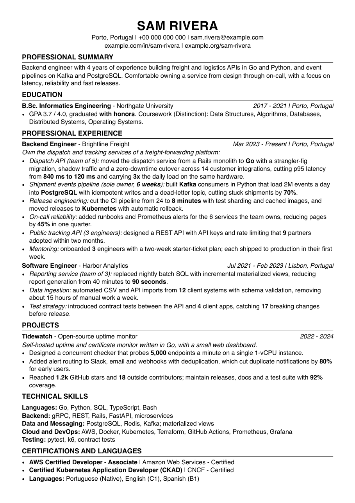
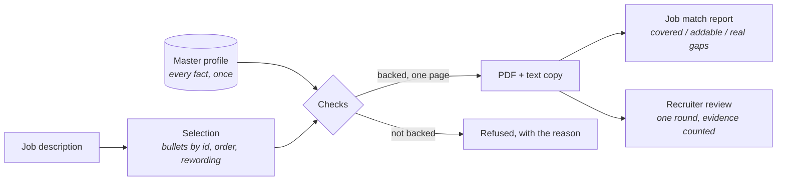

# cv-builder

[](https://github.com/abdelhaleemosama/cv-builder/actions/workflows/ci.yml)
[](LICENSE)

One master profile, any number of tailored one-page CVs. A CV can only **select** from what is true: every claim is checked against the profile before a PDF is written.

<p align="center"></p>

<p align="center"><sub>Generated from the fictional profile in <a href="examples/master.toml"><code>examples/</code></a>: one page, proof numbers in bold, working links.</sub></p>

## Why

Keeping a dozen hand-edited CV variants means they drift and contradict each other. Asking a language model to tailor a CV is faster, but it will happily invent a metric or a technology to fit the job.

This tool separates **facts** from **presentation**. Facts live once, in a master profile. A tailored CV is a small *selection* (which bullets, in what order, how reworded) that a person or an AI assistant writes. The builder then refuses anything the profile does not back, in code, and prints what the job asks for that you genuinely lack.

## How it works



## Quick start

Needs Python 3.11+ and a Chromium-based browser (Chrome, Chromium, Edge or Brave) for printing the PDF. There is nothing to `pip install`.

```bash
git clone https://github.com/abdelhaleemosama/cv-builder && cd cv-builder
```

```bash
bin/cv init
```

`init` creates `profile/master.toml` and `selections/general.json` from a fictional example. Replace the facts with your own, then:

```bash
bin/cv outline
```

```bash
bin/cv build selections/general.json
```

For a specific job:

```bash
bin/cv new "Company" "Role" --job posting.txt
```

```bash
bin/cv build applications/<the folder it printed>
```

`pip install -e .` also installs a `cv` command.

## The checks

`cv build` refuses to write a PDF when:

| Check | Example it stops |
| --- | --- |
| A bullet id is not in the profile | Asking for a bullet that was never written |
| A skill is not mentioned anywhere in the profile | Listing Kubernetes without having it |
| A reworded bullet has a number its source lacks | "Cut latency by 40%" on a bullet that says nothing about 40% |
| A reworded bullet names a technology the profile lacks | Swapping "Kafka" for "Pulsar" to match a posting |
| A custom summary states a figure no stored summary states | "9 years of experience" backed only by "9 partners" elsewhere |
| The CV runs past one page | Anything that would need a second page |
| The summary is over 60 words | A paragraph where three lines belong |
| A skill or a bullet appears twice | The same line under two jobs |
| More than ten keywords are bolded | Emphasis that stops standing out |

It also *points out*, without refusing: bullets with no number, several bullets that open with the same verb, and a phrase repeated across bullets. After printing, it checks the PDF really contains clickable links for the email and profile links.

## Reading a job description

`cv build` (and `cv check`) sorts the terms a job description uses into three lists:

- **in the CV**: covered.
- **true but not shown**: in your profile, left off this CV. Consider adding them.
- **not in your profile**: real gaps. They are never added; they are what to learn, or to mention honestly.

## Selections

A selection is plain JSON. The example in [`examples/general.json`](examples/general.json) shows every field:

```json
{
  "summary": "default",
  "bold": ["Go", "Kafka"],
  "experience": [
    { "id": "brightline", "items": [{ "id": "dispatch-api", "variant": "long" }, "event-pipeline"] }
  ],
  "skills": [
    { "group": "Data and Messaging", "items": ["PostgreSQL", "Kafka"], "also": ["materialized views"] }
  ]
}
```

A bullet is an id (its `short` wording), `{"id", "variant": "long"}` for the fuller wording, or `{"id", "text"}` to reword (checked as above). Master-profile text uses `*italic*` for a bullet's lead-in, `**bold**` for the numbers that prove the work, and `[label](https://...)` for links.

## Recruiter review

After a CV is built, a separate reviewer reads it against the job description knowing nothing else: first a ten-second skim, then a hiring-manager read that must **quote the CV** as evidence for each requirement. `cv review` verifies every quote is really in the CV, prints "must-have requirements with quoted evidence: N of M", and separates what rewording can fix from real gaps. One round by default, a second only to confirm the fixes, never more.

There is deliberately no score: a model's "82%" moves several points between runs, and a loop that chases it rewards keyword stuffing. A count of quoted evidence is repeatable.

## With Claude Code

```bash
bin/cv install
```

installs a `tailor-cv` skill and a `cv-recruiter` agent into `~/.claude`, with this tool's paths filled in. Then paste a job description and say "tailor my CV": Claude writes the selection, builds, checks, runs the review and reports the gaps as questions for you. The agent is told it cannot add a fact; the builder enforces it.

## Privacy

A CV is personal data, so none of it is in this repository.

- `profile/`, `selections/` and `applications/` are git-ignored. Set `CV_HOME` to keep them elsewhere, or `CV_PROFILE` to point at a different profile file.
- Everything in `examples/`, the tests and the screenshot above is a fictional person.
- A test fails if a tracked file contains a real email address, a personal path, or anything under the private folders.

## Development

```bash
python -m unittest
```

```bash
ruff check . && ruff format --check .
```

The PDF tests run only when a Chromium-based browser is available. See [docs/ARCHITECTURE.md](docs/ARCHITECTURE.md) for the design.

## Limits

- A4, one page, English, one column of plain text (what applicant tracking systems parse best).
- The technology vocabulary behind the job match and the "no new technology" check holds about 200 common terms ([`cvbuild/vocabulary.py`](cvbuild/vocabulary.py)); an unknown term is not checked, so extend the list for your field.
- The checks guarantee a CV does not contradict the profile. They cannot tell whether the profile itself is true.

## License

[MIT](LICENSE)
